# 学练agent-应试学习,学习ai,题库搜索,练习反馈

**StudentBuddy：开源 AI 学习 Agent，把资料、练习、思考、反馈和复习接在一起。**

产品本体仍叫 **StudentBuddy**，仓库名为 **xuelian-agent**。面向中文自学者、编程入门学习者与应试练习，支持 AI、Agent、JavaScript 等知识学习。从具体问题与可追溯资料开始，逐步进入练习、反馈和复习。

- **应试学习与题库搜索**：圈定考试范围与资源站，检索真题/题库来源，区分真实来源与 AI 生成练习；AI 可发现新资源站，经你确认后补入范围。
- **编程与 AI 入门**：对照教程或 GitHub 仓库提问，围绕刚学的概念出题，把「会看代码」进一步检查成「能解释与作答」。
- **练习反馈**：按题保存答案与思考，逐题解析；评价难度、步骤或歧义，再生成针对性练习。未答完也能交卷，未答题如实记录。
- **知识复习**：概念沉淀为词条，连接词卡、复习计划与知识大陆；Windows 悬浮窗口可共读网页、截图提问和定时练习。

[立即体验](https://11wand.com/) · [Windows 本地版](https://github.com/llwand1/xuelian-agent/releases/tag/desktop-stable) · [等待时刷词](#等待时刷词把等回复的空档变成一次小复习) · [阅读模式](#阅读模式把外部资源变成学习材料) · [知识大陆](#词条卡牌与知识大陆)

StudentBuddy 把提问、查资料、做题和复习串在同一段学习过程中。你可以从营地里的一道热身题开始，也可以带着自己的问题或资料直接进入。

## 学习工作台：从资料到练习反馈

围绕一份资料或一个具体问题，完成「阅读 → 作答 → 分析 → 调整练习 → 复习」。资料、答案与解题思考保留在同一学习过程中，方便回看与继续学习。

| 使用场景 | 操作方式 | 学习记录 |
|---|---|---|
| 检查概念理解 | 提交答案与「我的思考」，查看逐题分析，评价难度或歧义 | 原题、思考、反馈与后续练习连续保留 |
| 等待回答时复习 | 在当前窗口练词，收到回复提示后回到原对话 | 词卡进度与对话分别保留 |
| 安排后续复习 | 将概念收入词库，通过复习队列与知识大陆继续练习 | 词条、复习阶段与作答记录相互关联 |
| 使用桌面材料学习 | 共读网页、框选截图或读取本机文本，并在任务中心查看执行状态 | 当前材料、任务结果和权限请求可查看 |

### 练习反馈：保留解题思考，调整后续练习

JavaScript 闭包入门示例：提交答案与思考后，查看分析并评价这道题；选择「先练环境创建」，后续题目聚焦创建环境的语句。**以下演示来自实际组件，题目与模型回复使用隔离预置数据。**

查看评价之前：原答案、解题思考与评价选项

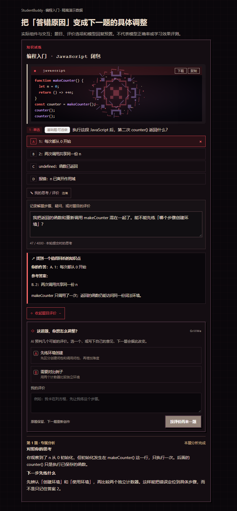

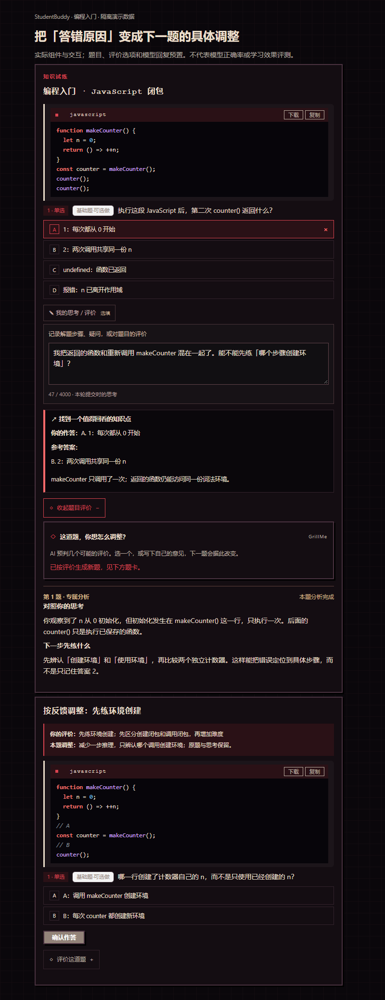

### 等待复习：回答与词卡保持连续

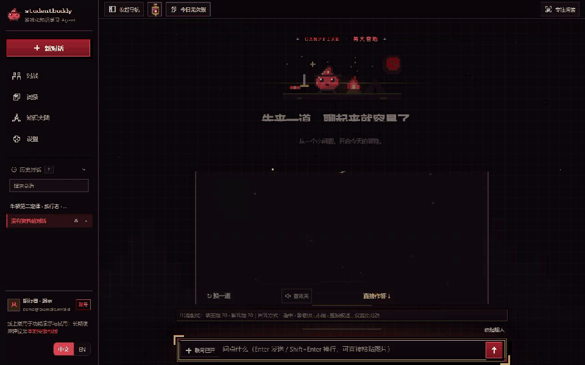

等待期间可继续练词，回复完成后收到提示，回到原对话接着阅读；词卡进度与对话内容不会因切换丢失。

### 资料共读：对照阅读，继续追问与练习

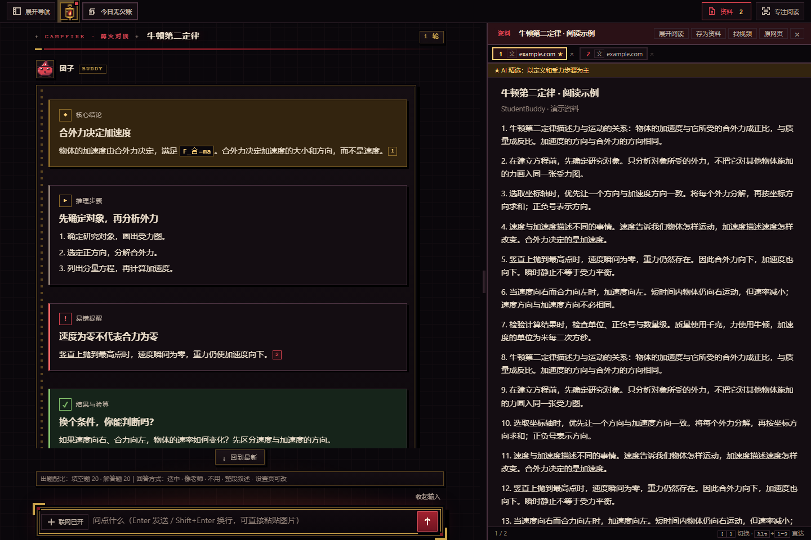

资料与回答对照阅读，划选不理解的段落继续追问，再围绕当前材料出题或收入词条。[功能说明](docs/FEATURES.md) · [演示来源记录](docs/images/learning-feedback-evidence.json)

### 学习偏好如何生效

StudentBuddy 更新的是你的学习状态，不是训练或改写模型本身。已有跨会话画像、明确回答风格、常学领域、未解决误区、难度调节、FSRS 复习与题目评价链路；这些记录会进入后续讲解、练习或复习安排。难度估计至少需要 8 条有效作答，FSRS 个人缩放拟合至少需要 30 条有效复习样本，之后每新增 20 条再拟合。

短对话不一定马上沉淀长期画像；累计兴趣不等于近期兴趣。当前尚无完整的冲突记忆修订、学习计划自动改写或在线效果对照。[个性化现况与视频学习契约](docs/BILIBILI-COMPANION-SPEC.md)。

### 桌面学习来信与视频练习

新版定时出题先由吉祥物在旁边发出邀请：「某考点的小题出好了，快来挑战一下吧！」点击「挑战一下」才展开题卡；也可延后两分钟。中文逐字显现、像素字符符文和表情随备题、待挑战、答对或答错变化；减少动态效果时保持完整静态文案。自动出题仍默认关闭，不抢焦点、不堆题。

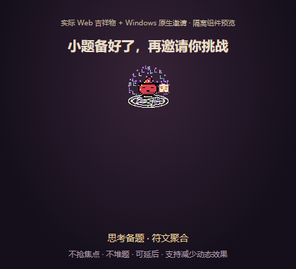

上图与下图来自实际组件，视频候选、材料和模型输出使用隔离预置数据；不包含个人学习内容。[演示来源记录](docs/images/bilibili-companion-evidence.json)。

B站学习插件在设置中显式启用，点击即可在指定浏览器打开 B站，无需 Token。AI 可按你的学习方向推荐真实视频与资料，选择视频后从实际简介、同视频共读划选或你提交的字幕/笔记出题，并推荐其他相关视频。没有讲解文字时会要求补充材料，不把标题当成“已经看完视频”；此版不是账号授权，也不读取观看历史或自动转录整段音视频。桌面出题范围可选「B站学习视频」。

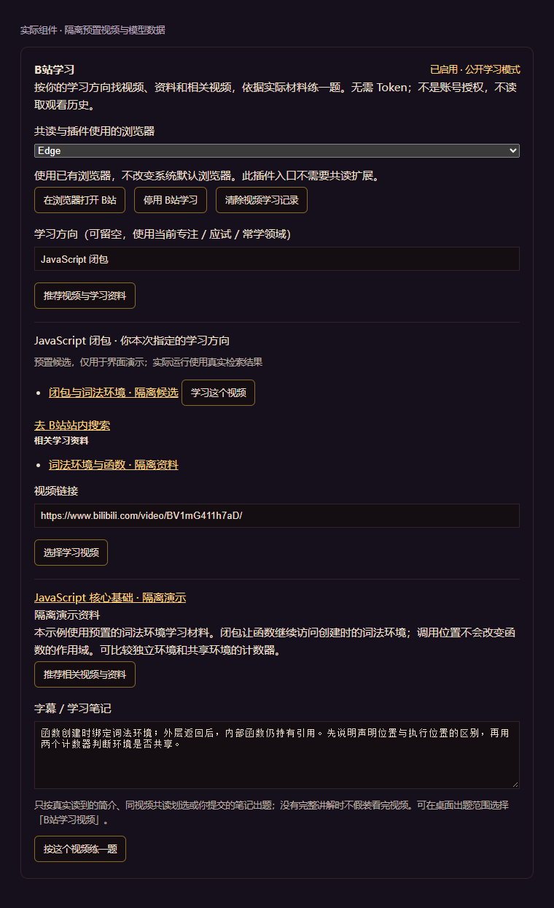

Windows 本地版把学习窗口和像素吉祥物带到桌面，学习数据留在自己的电脑上。新版会后台检查并准备更新，校验完成后提示重启；0.2.0 及更早版本需要先手动安装一次带更新器的新版。

本地桌面构建新增引路灯旁的「☷ 任务中心」：独立查看任务、一级子 Agent、逐题分析和后台队列。电脑文件按需只读，工作区可读写文本，敏感文件逐次许可；任务和工作区设置保存在本机。机制与访问范围见 [桌面 Agent 与工作区说明](docs/DESKTOP-AGENT-WORKSPACE-SPEC.md)。

悬停吉祥物可选择输入提问或截图提问。截图先框选和本机预览，再放入当前输入框；点击发送才交给配置的视觉模型，不自动上传或持续采屏。详见 [本机截图与快问](docs/DESKTOP-CAPTURE-SPEC.md)。

| 你想做什么 | StudentBuddy 如何接住 |
|---|---|
| 找个起点 | 现场热身题先带你动手；引路灯根据当前对话与学习进度推荐下一步，点选即可继续 |
| 理解一个概念 | 回答用核心、步骤、例子、误区和自检卡片组织，配合数学公式与清晰的白底图解 |
| 找更好的学习资料 | 搜索来源可追溯，文章、文档和视频都有入口；资料与回答对照阅读，也能跳到原平台继续看 |
| 等 AI 回复 | 刷几张词卡，复习到期词条、认识话题里的新词；回复到了，再顺着回去阅读 |
| 检查自己懂没懂 | 让 AI 出题、逐项作答、查看解析和图文复盘；回答还能提炼成可练习的题目 |
| 想让题目更合适 | 评价这道题，AI 预判可能的意见，也接受自己的话；下一题按评价调整，并说明改了什么 |
| 练习表达与推理 | GrillMe 围绕当前对话、应试范围或自定义主题按需追问；明确的问题直接开始，收尾路线点选后继续 |
| 把学过的记住 | 概念进入词库，变成卡牌和知识大陆上的地块，复习重新回到具体的知识 |
| 和别人一起练 | 进入对战，用作答、连击和比分反馈推进同一组题目 |

## UX：从入场到复盘

**界面围绕“阅读 → 作答 → 理解 → 记住”组织。** 暗黑像素冒险场景提供明确的学习入口；进入对话后，主要空间交给回答与资料。引路灯、复习和输入保持可达，按需要展开。

以下截图和动效来自实际前端，题目、回复与资料使用隔离演示数据。

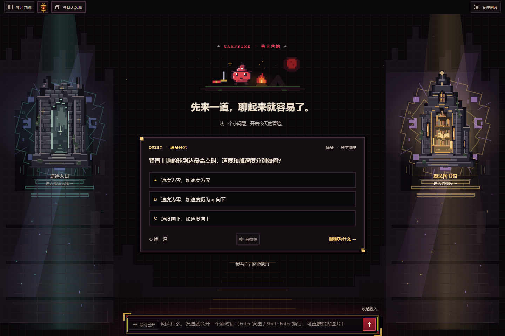

**从一个问题开始。** 空对话现场召来热身题，答完可以接着问“为什么”，也能直接输入自己的问题。收起导航后，魔法图书馆接替词条库入口，遗迹接替知识大陆入口；展开导航时建筑退场。两者进入真实学习页面，返回保留当前题目、答案和草稿。

查看答题反馈与营地 → 首条回复的动态衔接

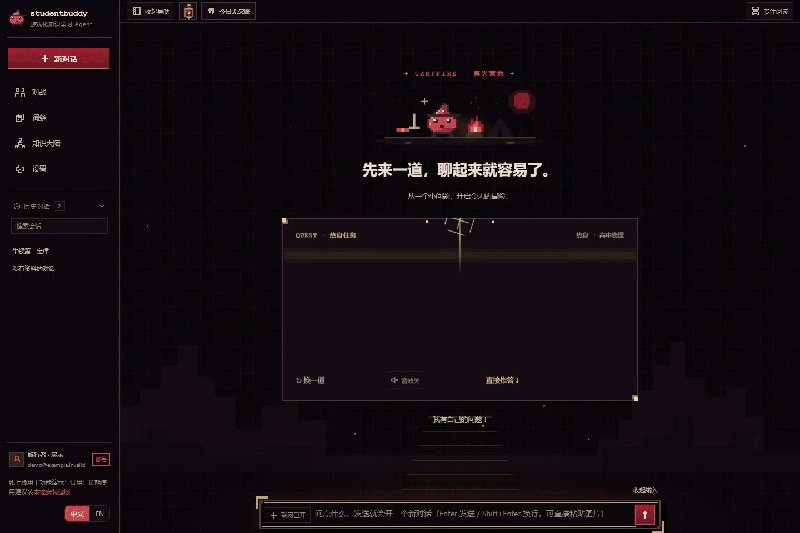

开会话时保留眼前的题目，首问实际发出后以魔法光痕收束营地，标题和回复同时进入。动画期间回复已经可读，输入和停止生成仍可操作；历史恢复与后续对话不重复播放。

### 等待时刷词：把等回复的空档变成一次小复习

**离开小屏幕，也能练一题。** Windows 悬浮球可开启定时练习，默认每 3 分钟弹出独立小题卡；在卡片里直接作答、看解析和接收像素魔法反馈。做完或跳过后重新计时，可延后两分钟，不连续堆题；练习范围可选当前学习方向或正在共读的网页。右键吉祥物或托盘菜单即可设置。

**问题已经发出，学习还可以继续。** 桌面开启自动刷词后，AI 回复等待超过 2 秒就出现词卡；很快完成的回复不会打断你。手机由你主动点开“刷词”，把屏幕留给正在阅读的回答。

**一张卡就能完成一个小动作。** 看词选义、看义选词和拼写交替出现；答对有命中与连击反馈，答错展开释义，隔几张再巩固。到期词条答对会完成一次复习打卡；跟着当前话题出现的新词先学再答，喜欢就收入自己的词库。

**回复来了，接得上刚才的思路。** 小窗提示“回复到了”，答完当前卡后回到对话；也可以“现在回去”或“继续刷”。小窗能拖动、收起，唤回时保留这一局的词卡和进度，音乐与音效可单独关闭。

查看收入词库与斩词的专属反馈

**刷词里的动作各有反馈。** 答题在五款特效间轮换；收入词库成功后书页聚拢、印记落库，保存期间不重复提交，失败留卡重试。“斩”用一刀切开词条与碎屑退场，表示今天不再出，不伪装成答对或永久掌握。两者保持独立的形状、颜色和短音，沿用音效开关与减少动态效果设置。

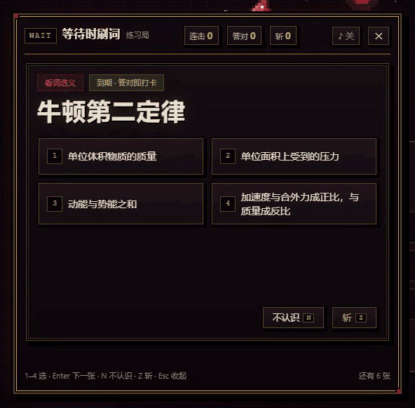

### 像参考答案一样阅读数学

分数有分数线，根号与上下标正常排版。计算讲解先给路线，再把推导一行行写清、对齐等号，最后代入验算；浅色答案纸嵌在像素冒险界面里，支持复制公式与放大。长公式在纸面内部滑动，手机阅读也不会把整页撑宽。

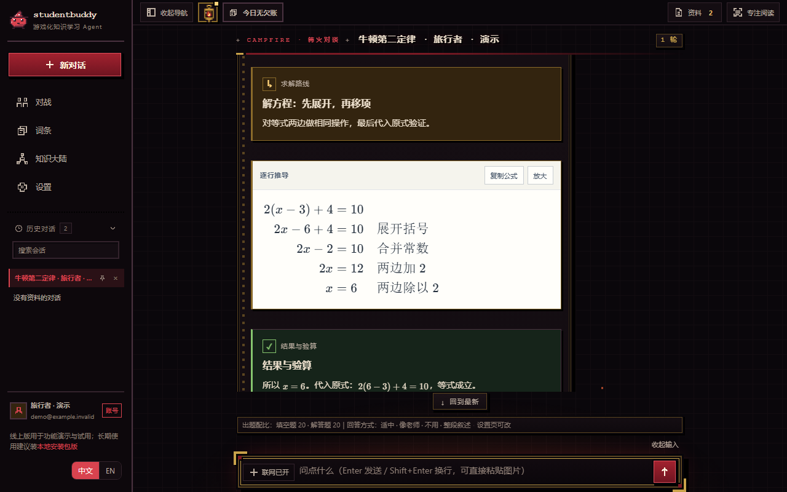

流程、关系、时序与思维图自动布局，配在解释附近；图面保持白底，可查看原文、下载或放大。内容未写完时先留位置，遇到无法解析的式子和图解保留原文。

### 阅读模式：把外部资源变成学习材料

**本地版可以就在你选定的 Chrome / Edge 里共读。** 从更多功能「网页共读」跳转浏览器，连接当前对话，再从扩展点击「共读当前页」。首次直接在共读页面下载扩展 ZIP，解压并在浏览器加载一次，不必查找安装目录；页面按下载、解压、加载、刷新逐步说明，未检测到扩展时不会假装已经连上。之后不用填写地址和配对码；内置窗口作为备用保留。正文、划选和阅读视野随阅读更新为临时资料，AI 在绑定对话检索相关段落再回答；停止共读或断连后清除。详见 [连接说明](tools/browser-extension/README.md)。

**让正文拥有稳定的空间。** 搜索更新资料入口和引用，用户主动打开后才进入对照阅读。桌面左右、手机上下，可拖动分界线，也可展开资料单独阅读。导航、输入都能收起，草稿和题卡继续保留。

**沿着资料继续探索。** 阅读器保留网页正文、章节、图片和出处。正文中的链接可确认后在阅读器内翻页，读完返回上一页；也能点“原网页”或“新标签页”去原平台。划选一段可进入速查，讲解、出题或提炼词条；“存为资料”把选中的来源绑定为当前会话材料，之后继续围绕它提问。

**多平台资源有各自的入口。** 从回答脚注或资料头部点“找视频”，按知识点搜索并切换线路；AI 也能调用视频工具换搜索词、追加检索、筛选和重新排序，结果会实时更新。只能保留实际检索到的视频，不编造链接，不自动播放。[浏览器与视频工具边界](docs/DESKTOP-BROWSER-VIDEO-SPEC.md)。

| 学习资源 | 如何使用 |
|---|---|
| 网页教程、官方文档与文章 | 联网找到的来源进入资料架，可对照/展开阅读、选段学习、跟随正文链接；原站始终可打开 |
| B站讲解视频 | 视频线路搜索，命中后用官方播放器就地播放，也可打开原视频或带关键词的站内搜索 |
| 抖音讲解视频 | 搜索结果与站内搜索入口跳转到抖音，在新标签页继续看 |
| YouTube 来源视频 | 已识别的视频来源使用官方播放器，或通过原网页进入 YouTube |
| PDF 与图片资料 | 按来源类型在资料架查看，引用回到出处，原网页继续可达 |

需要登录、权限或无法嵌入的资源可以打开原站。内置阅读器无法取得完整正文时保留原网页出口；平台搜索没有命中时仍提供站内搜索。你可以在外部找到更好的讲解，再把资料带回 StudentBuddy，接着提问、练习和存词条。

**手机同样围绕阅读设计。** 复习、导航和引路灯集中在顶部；输入靠底边并可收起。临时工具按需打开、限制高度，手机等待时刷词由用户主动进入。资料与对话分别滚动，切换布局保留正在阅读和作答的位置。

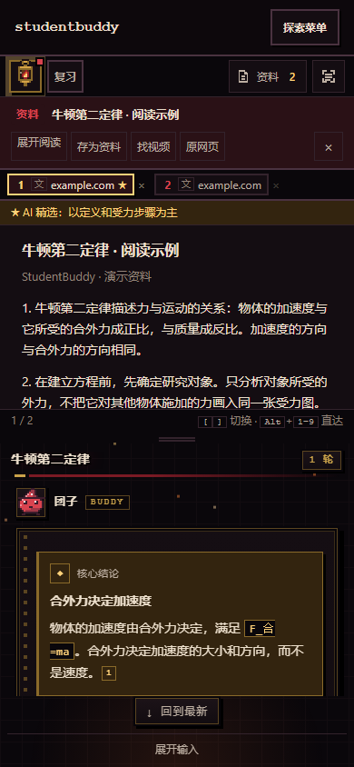

| 用户的下一步 | 界面如何接住 |
|---|---|
| 看懂回答 | 核心、步骤、例子、误区和自检以专属学习卡片组织；数学与白底 SVG 图解保留清晰度，引用点回资料 |
| 把刚学的练一遍 | 可提炼的结构化回答完成后显示轻提示；用户再说“考我”时可取用这道练习，题卡沿用作答与复盘流程 |
| 确认自己的答案 | 按压、命中斩光、失误碎光、连续命中与完成反馈响应真实判定；待评分与部分正确单独呈现，反馈音效主动开启 |
| 理解为什么错 | 题目提交后展开答案与解析，完成一组可进入图文复盘、重练；GrillMe 可选当前对话、应试范围或自定义主题 |
| 让知识留下来 | 对话概念沉淀为词条，回复里可速查，卡牌和知识大陆承接复习；外部 coding agent 也可通过专用接口存入带来源的词条 |

建筑本体固定，魔法发生在光柱、门光、结界与粒子上。进入阅读后场景收束，正文保持清晰；也支持减少动态效果。

## 词条、卡牌与知识大陆

**词库是这场冒险的积累。** 对话里学过的概念可以沉淀为词条；再次在回复中遇到时，直接查看解释和卡面。词条页把星级、卡墙、宝箱和任务放在一起，方便回看已经学过什么。

**复习变成收复自己的地图。** 词条在知识大陆上形成地块，到期知识会出现等待挑战的怪物。答题、看解析、完成复习，让每一次探索都回到实际学过的内容。复习范围可以按自己的学习方向选择。

**外部资料也能带进来。** 用自己的长文档或图片提问，围绕材料练习；还可以让外部 coding agent 通过专用词条接口补充带来源的知识，再回到这里阅读和复习。

## 外部 agent：词条与出题预产物

在设置页创建专用密钥，coding agent 可以发挥自己的搜索能力补充词条；勾选出题预产物后，还能提前准备考点依据、误区、评分要点和变化蓝图。StudentBuddy 在篝火与练习中优先取用符合当前方向、范围和期限的预产物，每次现场生成新题。

数学参数配方可直接生成并验算，减少召题等待；一般蓝图由 AI 现场创作、核对。指定实时搜索或真题时保留真实检索。设置页可复制 agent 使用说明，[接口契约](docs/QUESTION-SEEDS-SPEC.md)与[机器规范](https://11wand.com/api/open/v1/openapi.json)提供完整字段与示例。

## 桌面插件与更新

设置 → 插件 → GitHub：选择 Chrome / Edge，点击连接，在该浏览器授权，再勾选仓库。接入固定校验的 GitHub 官方 MCP 组件，主对话可读取选中仓库的文件、Issue、PR 与 Actions；高级 Token 连接保留。浏览器令牌仅在内存，退出应用需重新连接。

可导入声明式 JSON 接入其他公网 HTTPS Streamable HTTP MCP 服务，不运行第三方脚本；第三方工具逐次确认。配置、工具清单和调用记录可见。未开放子 Agent 插件权限、GitHub 写操作或插件商店。[插件契约与格式](docs/PLUGIN-ECOSYSTEM-SPEC.md)。

桌面构建通过测试、隔离升级验证和签名后进入 [desktop-stable 更新通道](https://github.com/llwand1/xuelian-agent/releases/tag/desktop-stable)，以发行页显示版本为准。扩展 ZIP 也随正式桌面 Release 单独提供。仓库改名不改变 StudentBuddy 的程序名、旧数据目录和更新签名。

## 开始体验

- **在线使用**：[打开 StudentBuddy](https://11wand.com/)，首页可免注册体验。公用体验账号的内容共享，私人学习资料请放在自己的账号里。
- **本地使用**：[下载 Windows 安装包](https://github.com/llwand1/xuelian-agent/releases/tag/desktop-stable)，安装后在设置里配置自己的 AI 服务商。
- **继续了解**：[功能说明](docs/FEATURES.md) · [外部 agent 存词接口](docs/AGENT-TERMS-SPEC.md) · [更新记录](CHANGELOG.md)。

开发者信息

当前测试基线 **463 文件 / 4894 例**。Windows 安装包见[桌面更新通道](https://github.com/llwand1/xuelian-agent/releases/tag/desktop-stable)；在线体验**已上线到 v0.2.186**。

代码结构、开发约定与复验方式见 [工程文档](docs/ENGINEERING.md)。

